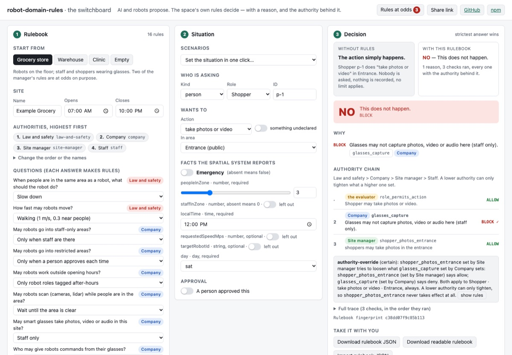

# robot-domain-rules

**AI and robots propose. The space's own rules decide — with a reason, and the authority behind it.**

[](https://github.com/NeuroverseOS/robot-domain-rules/actions/workflows/ci.yml)

**[▶ Try it live](https://neuroverseos.github.io/robot-domain-rules/)** · **[PRINCIPLES](PRINCIPLES.md)** · **[SPEC](SPEC.md)** · **[BOUNDARY](BOUNDARY.md)** · **[KNOWN GAPS](KNOWN-GAPS.md)** · [Related work](RELATED-WORK.md)

One rulebook for a physical space, written under authority the space declares, applied the same way to every robot, every person wearing glasses and every AI agent in it. Before acting, a participant asks and gets **yes / slower / wait / no**, with the rules that decided, who set each one, and the fingerprint of the rulebook in force. An AI planner can ask about a **whole plan** and get the same answer step by step, on the facts each step leaves behind. Pure TypeScript, zero dependencies, no clock, no network, no model inside the decision.

## Where AI fits

AI writes rules — from a manager's plain words, from documents, from a policy system — at whatever authority the space has granted it. AI proposes actions and plans tasks. AI explains decisions. The final "may I?" check is none of those: it is deterministic, takes microseconds, gives the same answer every time, and cannot be talked out of a rule. The same check runs over a whole plan before any step runs: each step on the facts the earlier steps project (the site declares what its actions do), plus rules about the plan as a whole — where it must end, what must come before what, how many of something. The planner proposes; the rulebook checks; it never writes the plan. This is one documented pattern for agents — AI authors policy, a deterministic engine decides; AWS AgentCore Policy, for example, compiles natural-language policies to [Cedar](https://docs.aws.amazon.com/bedrock-agentcore/latest/devguide/policy-natural-language.html) and evaluates them without a model — and the reason is plain: rules that a model interprets at runtime can be talked around. [RoboGuard](https://arxiv.org/pdf/2503.07885) reports that without its guardrail, attacked LLM-controlled robots executed unsafe plans more than 92% of the time; its figure supports the general point that guardrails outside the model help. Here the model is upstream of the decision, never inside it. See [RELATED-WORK.md](RELATED-WORK.md) for how this sits next to Cedar, ASIMOV, RoboGuard and Open-RMF.

## For engineers, and the agents that work with you

You will not adopt this package; you will take the principles, the format and the tests. That is the point.

1. **Read [PRINCIPLES.md](PRINCIPLES.md)** (5 minutes): nine rules for spaces shared by people, robots and AI, each one enforced by named conformance cases.
2. **Read [SPEC.md](SPEC.md)** (20 minutes): the rulebook, request, decision, plan, finding and approval formats; the decision and plan algorithms as numbered pseudocode; the exact conflict analysis and its witnesses; canonical JSON and the fingerprint, byte for byte; signed approvals. JSON Schemas in [`spec/`](spec/).
3. **Run [`conformance/`](conformance/) against your implementation** — 231 language-neutral JSON cases, one line each saying what it proves, with fixed Ed25519 test vectors and SHA-256 vectors. The loop is twelve lines; [`conformance/README.md`](conformance/README.md) gives the exact comparison rules (deep semantic equality; key order never matters). SPEC.md § 14 says which parts a client needs (evaluate, fingerprint verify, approval verify) versus authoring tools, and what a C#, Rust or Python port must get right. The reference passes its own suite in both [`test/conformance.test.ts`](test/conformance.test.ts) and the framework-free [`conformance/run-node.mjs`](conformance/run-node.mjs); every case input and reference output is validated against the JSON Schemas in CI.
4. **Test rules against your own logs before going live.** `backtest(rulebook, events)` replays a recorded log — what participants asked, and if you have it what then happened — and reports what the rulebook *would have decided*: totals by area, role and rule; rules that never fired; rules that would have stalled work; conflicts that actually occurred; gaps; facts the log did not carry; and where the rule and the record differ. `compareBacktests` sets a current rulebook against a proposed one on the same log. Pure, deterministic, no model; it applies rules, it does not explain. [SPEC.md § 13](SPEC.md), [`conformance/backtest.json`](conformance/backtest.json), [`examples/backtest/`](examples/backtest/).

   ```ts
   import { backtest, compareBacktests } from '@neuroverseos/robot-domain-rules';
   const events = log.map(l => ({ at: l.timestamp, request: l.request, outcome: l.entered ? 'happened' : 'did_not_happen' }));
   const current = backtest(rulebook, events);              // current.wouldStall, .neverFired, .conflictsOccurred, .gaps, .missingFacts, .differences
   const change = compareBacktests(current, backtest(proposedRulebook, events));
   // change.newlyAllowed, change.newlyBlocked, change.byRule → "should we raise the aisle-5 limit?" answered from the record
   ```

5. **Trust the conflict analysis, or check it.** It is exact for the rule language: two rules are reported as able to meet if and only if some request matches both, and every finding carries a witness request that triggers both rules. [`test/z3-crosscheck.test.ts`](test/z3-crosscheck.test.ts) encodes generated rulebooks into the Z3 SMT solver and asserts agreement on every pair — 306 seeded rulebooks, 1,836 pairs (1,115 overlapping, 721 disjoint), 1,115 witnesses, in about 6 s. z3-solver is a devDependency only; nothing of it ships.

Or use this package directly:

```bash
npm install @neuroverseos/robot-domain-rules      # Node 20+ (Ed25519 via WebCrypto)
```

```ts
import { DomainRulesBuilder, evaluateDomainAction } from '@neuroverseos/robot-domain-rules';

const builder = new DomainRulesBuilder({ id: 'store-1', name: 'Store 1', hours: { open: '07:00', close: '22:00' } })
  .fromTemplate('grocery-store')
  .area({ id: 'aisle-3', name: 'Aisle 3', tags: ['public'] })          // IDs your spatial system reports
  .role({ id: 'inventory_robot', name: 'Inventory robot', kind: 'robot', actions: ['enter_zone', 'move', 'scan', 'dock'] })
  .answer('robots_near_people', 'slow')
  .as('site-manager');                                                  // the authority the next rules are set by
builder.confirm(builder.addRuleFromText('robots slow to 0.3 m/s in aisle 3'));
const rulebook = builder.compile();                                    // frozen JSON; rulebook.findings lists rules at odds

const decision = evaluateDomainAction(rulebook, {
  participant: { id: 'robot-7', kind: 'robot', roleId: 'inventory_robot' },
  action: 'move', areaId: 'aisle-3',
  facts: { peopleInZone: 2, localTime: '14:05', requestedSpeedMps: 1.0 },
});
// decision.status → 'LIMIT'; decision.limits → { maxSpeedMps: 0.3 }
// decision.reasons → [{ ruleId: 'robots_near_people', status: 'LIMIT', setBy: 'law-and-safety', reason: '…' }, …]

const verdict = evaluatePlan(rulebook, {                                // a planner's whole plan, checked before any step runs
  participant: { id: 'robot-9', kind: 'robot', roleId: 'restock_robot' },
  initialFacts: { localTime: '09:30', peopleInZone: 0, requestedSpeedMps: 0.5 },
  clock: 'localTime', startTime: '09:30', stepDurationSeconds: 120,
  steps: [{ action: 'enter_zone', area: 'aisle-3' }, { action: 'manipulate' }, { action: 'enter_zone', area: 'checkout' }],
});
// verdict.status → 'BLOCK'; verdict.firstViolation → { stepIndex: 1, ruleId: 'scan_before_restock', setBy: 'site-manager', from: 'plan', … }
// verdict.steps[2].facts.carrying → true (manipulate's declared effect); verdict.approvalRequests → every approval the plan would need
```

- **An agent asks before it acts:** [`examples/mcp/`](examples/mcp/) is a ~100-line stdio MCP server with `may_i` and `explain_rulebook`. The MCP SDK is a dependency there only.
- **An AI planner's plan, rejected, revised, approved, accepted:** [`examples/harness/plan-replay.ts`](examples/harness/plan-replay.ts) checks two versions of a restock plan: v1 skips the shelf scan, carries stock into the checkout and ends away from the dock, and is rejected at step 2 with the rule, the reason and the authority; v2 passes every step but one, which needs a person — the manager signs that one approval and v2 is accepted. Readable transcript plus `plan-decisions.jsonl`. `npx tsx examples/harness/plan-replay.ts`.
- **Your spatial vocabulary:** [`examples/harness/`](examples/harness/) reads a semantic-volumes collection in the exact shape `aukilabs/domain-harness` stores (`{ schema, frame, items: [{ id, title, description, semantic_type, center, size, yaw }] }`, validated the way its Rust does, unknown fields refused), maps each volume to a rulebook area with its `semantic_type` as the tag, and replays an event stream — an AI planner proposing tasks, the spatial system reporting areas and people counts, a manager signing one approval, an alarm starting and clearing — into an append-only decision log. Membership (which volume a participant is in) is the spatial system's; the example has no point-in-box test. `npx tsx examples/harness/replay.ts`.
- **Rules that count what happened:** a rule may condition on the participant's recent `history` ("at most five scans an hour", "not within ten minutes of a lift"); the caller supplies it with the request, the clock is a declared time fact, and a rule that needs history and does not get it refuses.
- **Signed, expiring, single-use approvals:** declare `trustedKeys` on the rulebook and only an Ed25519-signed approval — verified in your trusted layer before evaluation, bound to the rule, the rulebook fingerprint, the participant, the action and the area, with a nonce and an `expiresAt`, judged against the `now` you supply — clears that rule's wait. It clears nothing else: a deny, a never rule or a condition wait on the current facts still decides. `signApproval`, `verifyApproval`, `verifyAndEvaluate`, `signRulebook`, `verifyRulebookSignature`. Without `trustedKeys`, plain approvals work (development only). **Facts come from the harness, never from the requester** ([BOUNDARY.md](BOUNDARY.md)).
- **A rulebook tested against a week of activity:** [`examples/backtest/`](examples/backtest/) replays a clearly labelled synthetic sample week (189 events, not from a real store) through a grocery rulebook with the rule "at most two robots in aisle 5": blocked entries the record says happened, three events with no occupancy count, a rule that never fired, the conflicts that occurred, and a comparison with "at most three". `npx tsx examples/backtest/backtest.ts`.
- **Already on Cedar?** [`adapters/cedar/`](adapters/cedar/) exports the deny/permit subset as Cedar policies and a schema, resolving authority first and listing every rule it cannot carry (limits, waits, history, plan rules). Tested against Cedar's own engine on every example request. Lossy, and says so.

## For operators

**[The switchboard](https://neuroverseos.github.io/robot-domain-rules/)** runs in your browser; nothing leaves the page.

[](https://neuroverseos.github.io/robot-domain-rules/)

Start from the grocery store, the warehouse, the clinic or an empty site. Answer the template's questions and watch the rules change. Write a rule in plain words, read the draft, confirm it as a chosen authority. Set who is asking, the action, the area, every fact, the emergency switch and an approval — or pick a scenario — and see **YES / SLOWER / WAIT / NO** with the limits, the reasons, the authority chain and the full trace, next to what would happen with no rules at all. Switch to **Plan** and load a planner's plan (the replay's v1 and v2 are presets), step through it on the projected facts, and see the first violation, every step's verdict, the plan rules and where it ends. Switch to **Test** to replay recorded activity through the rules before they go live: load the sample week or import your own JSON/JSONL log, read Allowed / Slower / Wait / Blocked / Missing facts, then the rules that never fired, the rules that would have stalled work, the conflicts that actually occurred, the gaps, the missing facts, and where the rule and the record differ; snapshot the rulebook, change a rule, and see what would change. It shows what the rules would have decided — not why things happened. The "Rules at odds" panel shows every conflict live, each with an example request that triggers both rules — one click puts it in the situation. Export the rulebook as JSON or readable text; import one (fingerprint verified); copy the code that asks it.

## Why not Cedar or OPA?

Cedar and OPA/Rego are mature, general policy languages with real tooling, and Cedar's analysis covers a richer language than this one. If they fit your stack, use them. What this project does that they do not, out of the box: rules authored from plain answers and plain words by whoever the space grants authority; a declared authority order where a lower level can only tighten, reported at compile time and enforced at decision time; two kinds of waiting (a person must approve, signed and bound to the request, versus the situation must change); one rulebook and one decision path for robots, people and AI agents; whole-plan checking on projected facts; and decisions that name the authority behind every rule. [`adapters/cedar/`](adapters/cedar/) compiles the deny/permit subset to Cedar and lists what it drops; the conformance cases are how you would check any such compilation for faithfulness.

## Roadmap: rules that learn from evidence

Rules should learn from what actually happens. Bevia, in development by the same author, reads decision logs and real-world evidence — rules that stall work for no reason, near-misses, conflicts that keep recurring — and proposes rule changes at an authority the space grants it. People or systems with higher authority accept them. Bevia never loosens a rule on its own, and every suggestion cites the evidence behind it.

Out of scope, on purpose: plan *synthesis* — planners propose; this checks. Also out of scope: explaining *why* things happened across sources. A backtest says what the rules would have decided for recorded requests, nothing more; that is what evidence systems such as Bevia (in development by the same author) are for.

## Repo map

| Path | What it is |
|---|---|
| [`PRINCIPLES.md`](PRINCIPLES.md), [`SPEC.md`](SPEC.md), [`BOUNDARY.md`](BOUNDARY.md), [`KNOWN-GAPS.md`](KNOWN-GAPS.md), [`RELATED-WORK.md`](RELATED-WORK.md) | The principles, the normative spec, what this is and is not, what it does not do yet, how it compares. |
| [`spec/`](spec/) | JSON Schemas (draft 2020-12) for rulebook, request, decision, plan, plan evaluation, findings, approvals, backtest input and report. |
| [`conformance/`](conformance/) | 231 language-neutral cases by principle (plus plans, history, backtest, versions), shared rulebooks, Ed25519 and SHA-256 test vectors, a framework-free runner, a schema validator, and the generator that produced them. |
| [`src/`](src/) | The core. Zero runtime dependencies. `types.ts` first; then `compile.ts`, `evaluate.ts`, `plan.ts`, `check.ts`, `backtest.ts`, `approvals.ts`, `canonical.ts` (RFC 8785 + SHA-256), `draft.ts`. |
| [`src/templates/`](src/templates/) | The template contract and the two shipped templates (`grocery-store`, `warehouse`), whose actions declare their effects. |
| [`examples/`](examples/) | A grocery store (two manager rules deliberately at odds, two plan rules), a warehouse, a clinic with no template, `demo.ts`; [`harness/`](examples/harness/) the semantic-volumes adapter, the agent replay and the planner replay; [`backtest/`](examples/backtest/) a synthetic sample week and the backtest; [`mcp/`](examples/mcp/) the `may_i` server. |
| [`adapters/cedar/`](adapters/cedar/) | The Cedar export. Its own package; lossy and says so; tested against Cedar's engine. |
| [`site/`](site/) | The switchboard, with Ask, Plan and Test modes. Its own package, built from `src/`; not published to npm. |
| [`test/`](test/) | Core tests (one per behaviour, plus the seeded exactness test), the Z3 cross-check, and the conformance runner. |
| [`AGENTS.md`](AGENTS.md) | Invariants and working rules for people and coding agents. [`CHANGELOG.md`](CHANGELOG.md) for what changed. |

```bash
git clone https://github.com/NeuroverseOS/robot-domain-rules && cd robot-domain-rules && npm install
npm test                                  # core tests + the Z3 cross-check + every conformance case
npm run build && node conformance/run-node.mjs && npm run conformance:schemas
npm run demo                              # three rulebooks in plain text, their findings, a day of decisions each
npx tsx examples/harness/replay.ts        # the agent replay
npx tsx examples/harness/plan-replay.ts   # the planner replay: rejected, revised, approved, accepted
npx tsx examples/backtest/backtest.ts     # a rulebook against a synthetic week of activity, and limit 2 vs 3
npm run site                              # the switchboard locally (cd site && npm install first)
npm run cedar:test                        # the Cedar adapter against cedar-wasm (cd adapters/cedar && npm install first)
```

## Stability

0.x: the API may still change between minor versions, and breaking changes will be batched rather than trickled. The specification is versioned separately (`robot-domain-rules/3`, see [SPEC.md § 11](SPEC.md)); a change that alters any decision, finding, fingerprint or signature for an existing valid rulebook bumps the spec version and ships with new conformance cases — 0.5.2 did (SHA-256 fingerprints, the `/3` approval contract, dated history), and every artifact declares its version: a `/2` rulebook or approval is refused by name with its migration, never reinterpreted. The 0.2 input shape is still accepted and decides identically.

The ideas come from the NeuroVerse governance work; this implementation is a 0.x reference built quickly with AI assistance, and audited (0.5.2 answers an independent engineer's audit, see [CHANGELOG.md](CHANGELOG.md)).

## License

MIT (versions 0.1.0 and 0.2.0 were published under Apache-2.0).
